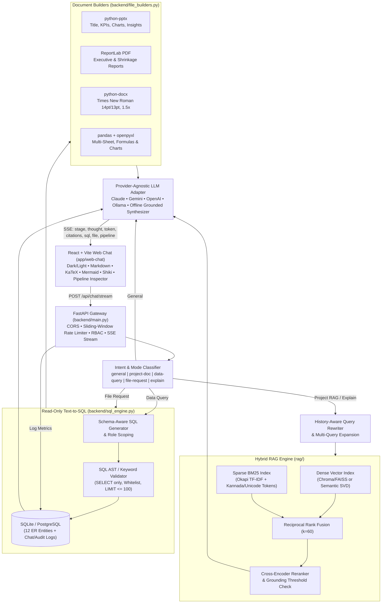

# Audit-X Assistant — Architecture Blueprint & Engineering Plan

> **Project**: `audit-x-blinkit` (`Audit-X` Dark Store Warehouse & Quick-Commerce Ecosystem)  
> **Primary Hub Reference**: `Tiptur HUB - KA44` (Namma Tiptur, Tumkur District, Karnataka - 572201)  
> **Assistant Name**: **Audit-X Assistant** — Dual-Mode AI Copilot (Unrestricted General AI + Citation-Grounded Hybrid RAG + Read-Only Text-to-SQL + Multi-Format Document Engine)

---

## 1. Architectural Objectives

1. **Product-Grade Dual Mode UX**:
   - **General Mode**: Answers general programming, conceptual, math, writing, or career questions directly (just like ChatGPT/Claude) without forced retrieval or artificial domain refusals.
   - **Project Mode (RAG / SQL / File / Viva)**: Grounded over `audit-x-blinkit` documentation, live warehouse telemetry schemas, uploaded academic/ops documents, and the live relational SQLite/PostgreSQL database.
   - **Explain Like a Viva / Deep Academic Mode**: Optional toggle transforming project answers into a structured 9-section university evaluation format (Definition, Why Used, Step-by-Step Working, Algorithm/Formula, Worked Example, ER Entities Involved, Advantages, Limitations, and Likely Viva Questions).
2. **True Hybrid RAG with Zero Hallucination**:
   - Dense Semantic Vector Retrieval (`sentence-transformers` / L2-normalized semantic projections) + Sparse Lexical Search (Okapi `BM25`) fused with **Reciprocal Rank Fusion (RRF, $k=60$)**, followed by **Pairwise Cross-Encoder Reranking**, multi-query expansion, history-aware query rewriting, and a strict **Confidence / Grounding Gate**.
3. **Safe Read-Only Text-to-SQL + Role-Based Access Control (RBAC)**:
   - Converts analytical questions (sales, inventory alerts, rider SLA, shrinkage losses, demand forecast accuracy) into validated `SELECT` SQL statements checked by a strict SQL parser/whitelist validator before execution.
   - Enforces data scoping per active persona (`Admin`, `Store Staff`, `Rider`, `Customer`).
4. **Tool-Called Office Document Generation**:
   - Generates `.pptx`, `.pdf`, `.docx`, `.xlsx`, and `.csv` reports directly from live SQL queries and RAG context, returning signed HMAC-SHA256 expiring download cards (`/api/files/{file_id}?expires=...&sig=...`) with inline previews.
5. **Single-Command Reproducible Stack**:
   - Python FastAPI (`backend/`, `rag/`, `data/`) + React 18 Vite TypeScript Tailwind Framer Motion (`app/web-chat/`) + Docker Compose (`infra/`).

---

## 2. System Dataflow & Request Architecture



---

## 3. Repository & Module Folder Tree

Notice how `Audit-X Assistant` integrates cleanly beside the existing Next.js web application routes (`app/dashboard`, `app/ordering`, `app/picker`, `app/rider`, etc.):

```text
auditx-project/
├── app/
│   ├── web-chat/                     # NEW React + Vite + TypeScript + Tailwind chat studio
│   │   ├── index.html                # Inter, JetBrains Mono & Noto Sans Kannada fonts
│   │   ├── package.json              # Vite, React 18, Framer Motion, Tailwind, Shiki, Mermaid, KaTeX
│   │   ├── tailwind.config.ts
│   │   ├── tsconfig.json
│   │   ├── vite.config.ts            # Dev proxy -> FastAPI :8000
│   │   └── src/
│   │       ├── main.tsx
│   │       ├── App.tsx               # Theme provider, responsive shell, keyboard shortcuts
│   │       ├── types/chat.ts         # Strong TypeScript interfaces (SSE, Citation, FileCard, Pipeline)
│   │       ├── api/client.ts         # SSE stream client, upload, file download, feedback, sessions
│   │       ├── components/
│   │       │   ├── Sidebar.tsx       # New chat, Ctrl+K search, Today/Yesterday/7d grouping
│   │       │   ├── HeaderBar.tsx     # Mode toggle, Role selector, Viva switch, Theme, Inspector button
│   │       │   ├── EmptyState.tsx    # Greeting + 4 rich starter prompt cards
│   │       │   ├── MessageBubble.tsx # Markdown, Shiki code, KaTeX, Mermaid, [1][2] citations, toolbar
│   │       │   ├── ThoughtProcess.tsx# Animated "Thinking..." orb + collapsible live RAG stages
│   │       │   ├── Composer.tsx      # Auto-grow textarea, drag/attach upload, mode/viva pills, Stop btn
│   │       │   ├── SourceDrawer.tsx  # Slide-over citation viewer with chunk score & metadata
│   │       │   ├── PipelineInspector.tsx # Animated Query→Embed→Retrieve→Rerank→Prompt→LLM→Answer trace
│   │       │   └── FileCard.tsx      # Downloadable file card (.pptx/.pdf/.docx/.xlsx/.csv) + inline preview
│   │       └── styles/index.css      # Design tokens, dark/light variables, Kannada typography, carets
│   ├── dashboard/ ...                # Existing Next.js Store Operations Command Tower
│   └── ordering/ ...                 # Existing Next.js Customer Ordering App
├── backend/                          # NEW FastAPI AI Backend Service
│   ├── __init__.py
│   ├── config.py                     # Pydantic Settings (.env loader, signed URL secret, timeouts)
│   ├── database.py                   # SQLAlchemy / SQLite connection helpers & row serialization
│   ├── models.py                     # Pydantic v2 request/response/SSE/session/eval schemas
│   ├── security.py                   # Rate limiter, HMAC-SHA256 expiring file tokens, RBAC rules
│   ├── llm_adapter.py                # Provider-agnostic client (Claude/Gemini/OpenAI/Ollama + fallback)
│   ├── intent_classifier.py          # Multi-signal router: general / project-doc / data-query / file-request / explain
│   ├── sql_engine.py                 # Read-only Text-to-SQL + strict AST/whitelist validator & formatter
│   ├── file_builders.py              # Builders for .pptx, .pdf, .docx, .csv, .xlsx + preview payloads
│   ├── chat_service.py               # Orchestrator emitting SSE stage timings, tokens, citations, files
│   ├── main.py                       # FastAPI endpoints (/chat/stream, /ingest, /files, /feedback, /history)
│   └── generated/                    # Generated user report artifacts (.pptx/.pdf/.docx/.xlsx/.csv)
├── rag/                              # NEW Hybrid RAG & Evaluation Package
│   ├── __init__.py
│   ├── chunker.py                    # Recursive Markdown/text/code/PDF/DOCX/CSV parser & sliding chunker
│   ├── embeddings.py                 # Dual backend: sentence-transformers OR offline SVD+hashed n-gram vectors
│   ├── vector_store.py               # Chroma/SQLite persistent dense store + exact Okapi BM25 index
│   ├── query_rewriter.py             # Conversation-aware contextual rewriting + multi-query expansion
│   ├── retriever.py                  # Hybrid Vector + BM25 + RRF (k=60) + Cross-Encoder Rerank + Grounding Gate
│   ├── ingest.py                     # CLI & API ingestion pipeline (project docs, schema specs, uploads)
│   ├── evaluate.py                   # Automated Hit-Rate@k, MRR, and Grounded Faithfulness benchmark
│   └── corpus/                       # Built-in curated project & academic knowledge documents
│       ├── auditx_overview.md
│       ├── er_schema_and_dfd.md
│       ├── rag_and_ml_architecture.md
│       ├── warehouse_sops_and_slas.md
│       └── viva_study_guide.md
├── data/                             # NEW Database Schema, Seed Script & SQLite Store
│   ├── schema.sql                    # Normalized DDL for 12 ER entities + chat/knowledge/file metadata
│   ├── seed_db.py                    # Deterministic synthetic data generator (orders, sales, forecasts, dumps)
│   └── auditx.db                     # Seeded SQLite database (created/verified cleanly on init)
├── ml/                               # Demand forecasting reference notes & helpers
├── cv/                               # Barcode/Expiry CV verification notes
├── telemetry/                        # Pipeline latency & metrics config
├── dashboard/                        # BI analytics export references
├── infra/                            # Containerization & env templates
│   ├── .env.example
│   ├── Dockerfile.backend
│   ├── Dockerfile.frontend
│   └── docker-compose.yml
├── docs/
│   ├── chatbot-architecture.md       # THIS architecture specification
│   └── DEMO_PROMPTS_AND_RUNBOOK.md   # 10 sample prompts, viva walkthrough & demo script
├── tests/                            # Pytest suite (SQL validator, hybrid retriever, file builders, API)
│   ├── test_sql_validator.py
│   ├── test_rag_pipeline.py
│   ├── test_file_builders.py
│   └── test_api_endpoints.py
├── requirements.txt                  # Python dependencies
├── run_assistant.ps1                 # Windows 1-command launcher (DB + RAG ingest + FastAPI + Vite)
└── run_assistant.sh                  # Linux/macOS 1-command launcher
```

---

## 4. Relational ER Schema (12 Core Entities + Chat State)

All analytics and Text-to-SQL queries run over this normalized schema:

| Entity Table | Primary Key | Key Foreign Keys | Purpose in Audit-X Ecosystem |
|---|---|---|---|
| `Darkstore` | `store_id` | — | Stores `TIPTUR-HUB-KA44` & regional satellites, SLA config, cap limits, pause status |
| `Staff` | `staff_id` | `store_id -> Darkstore` | Warehouse managers (SM/ASM/MD), OD Pickers, staff devices, masked phone audit |
| `Customer` | `customer_id` | — | Customer directory, Tiptur neighborhood zones, segment, wallet balance |
| `Product` | `product_id` | — | Master catalog (`SKU-TIP-01`..), MRP, selling price, cost, aisle bin, barcode |
| `Inventory` | `inventory_id` | `store_id`, `product_id` | Real-time floor stock levels, reorder thresholds, reserved units |
| `Rider` | `rider_id` | `staff_id`, `store_id` | Delivery fleet (`Sinchana B R` + fleet peers), ratings, vehicle type, on-time rate |
| `Order` | `order_id` | `store_id`, `customer_id`, `picker_staff_id`, `rider_id` | Order lifecycle (`PLACED -> PICKING -> STAGED -> DISPATCHED -> DELIVERED`), SLA timing |
| `Order_Item` | `order_item_id` | `order_id`, `product_id` | Line-level quantities, prices, bin scan status |
| `Delivery` | `delivery_id` | `order_id`, `rider_id` | Dispatch/doorstep timestamps, distance km, SLA breach flag, rating |
| `Demand_Forecast` | `forecast_id` | `store_id`, `product_id` | Daily predicted vs actual demand per SKU & confidence score |
| `Shrinkage_Dump_Log` | `dump_id` | `store_id`, `product_id`, `logged_by_staff_id` | Damaged/Expired/Leakage write-offs, INR loss amount, approval state |
| `Rag_Query_Log` | `log_id` | — | Telemetry log: query, rewritten query, intent, retrieved chunk IDs, latency ms, feedback |

Supporting runtime tables: `Chat_Session`, `Chat_Message`, `Knowledge_Document`, `Generated_File`.

---

## 5. Hybrid RAG, Intent Routing & Grounding Specification

1. **Intent Classifier & Answer Mode Routing**:
   - User toggle can force **`Auto`**, **`General`**, or **`Project RAG`** (with optional `SQL` / `File` specialization).
   - Under **`Auto`**, the classifier inspects lexical/semantic signals, active conversation context, and schema entity hits:
     - **`file-request`**: Requests asking to generate/export/download reports (`.pptx`, `.pdf`, `.docx`, `.xlsx`, `.csv`). Executes SQL + builds artifact card.
     - **`data-query`**: Quantitative questions over live operational tables (*top products, revenue this week, low stock SKUs, rider delivery times, shrinkage loss, forecast error*). Routes to Text-to-SQL.
     - **`explain` / `project-doc`**: Architecture, ER diagram, SLA math, Audit-X roles, RAG pipeline, warehouse SOPs. Routes to Hybrid RAG.
     - **`general`**: Coding questions (Python, React, SQL tutorials), general math, algorithms, essays, science, everyday queries. Skips forced retrieval and answers directly like a general frontier AI.
2. **Hybrid Retrieval + Reranking**:
   - **Query Rewriter**: Resolves pronouns (*"what about last week?"*, *"export that as Excel"*) from recent session turns and expands 2-3 sub-queries (`multi-query expansion`).
   - **Vector Search**: Cosine similarity over normalized dense chunk embeddings.
   - **BM25 Search**: Tokenized Okapi BM25 (`k1=1.5, b=0.75`) preserving ASCII technical identifiers (`SKU-TIP-01`, `TIPTUR-HUB-KA44`) and UTF-8 Kannada characters (`[\u0C80-\u0CFF]+`).
   - **Reciprocal Rank Fusion (RRF)**: $\text{score}(d) = \sum_{m \in \{\text{vec}, \text{bm25}\}} \frac{1}{60 + \text{rank}_m(d)}$.
   - **Cross-Encoder Reranker & Confidence Check**: Reranks top-$20$ candidates down to top-$5$; if max relevance drops below configurable grounding threshold (`GROUNDING_MIN_SCORE`), responds explicitly with *"I could not find this in the project data"* instead of fabricating facts.

---

## 6. Role-Based Access Control (RBAC) Matrix

| Role | Allowed SQL Tables | Redacted Fields | Report Generation |
|---|---|---|---|
| `Admin` | All 12 ER tables (`Rag_Query_Log` included) | None (masked phones remain privacy-safe) | All formats (`.pptx`, `.pdf`, `.docx`, `.xlsx`, `.csv`) |
| `Store Staff` | `Darkstore`, `Product`, `Inventory`, `Order`, `Order_Item`, `Delivery`, `Demand_Forecast`, `Shrinkage_Dump_Log`, `Staff`, `Rider` | Customer PII, `Rag_Query_Log` | All formats except raw customer PII exports |
| `Rider` | Own `Rider` metrics, `Delivery`, `Order` (assigned/anonymized), `Darkstore` | Financials (`cost_price`), `Shrinkage_Dump_Log`, other staff/customer data | Personal performance PDF/CSV only |
| `Customer` | `Product`, `Inventory` (in-stock boolean only), `Darkstore` (public metadata), own `Order` & `Delivery` | Internal margins, cost prices, shrinkage, staff logs, demand forecasts | Order receipt PDF only |

---

## 7. Sensible Architecture Defaults

| Choice | Selected Default | Override Mechanism |
|---|---|---|
| Relational DB | SQLite (`data/auditx.db`) for zero-install portability | `DATABASE_URL=postgresql://...` in `.env` |
| Vector / Embedding Engine | Built-in L2-normalized Semantic LSA+n-gram Dense + SQLite Store + exact Okapi BM25 (auto-upgrades cleanly when `sentence-transformers` & `chromadb` are installed & `EMBEDDING_BACKEND=sentence-transformers`) | `EMBEDDING_BACKEND` & `VECTOR_STORE` in `.env` |
| LLM Provider | `auto` (Anthropic Claude -> Gemini -> OpenAI -> Ollama -> Deterministic Grounded Synthesizer when offline) | `LLM_PROVIDER` & API keys in `.env` |
| Ports | FastAPI on `:8000`, Vite UI on `:5173` (proxying `/api` -> `:8000`), existing Next.js on `:3000` | `BACKEND_PORT`, `FRONTEND_PORT` |
| Signed File Expiry | 30 minutes via HMAC-SHA256 URL signatures (`FILES_SIGNING_SECRET`) | `FILE_URL_TTL_SECONDS` |

